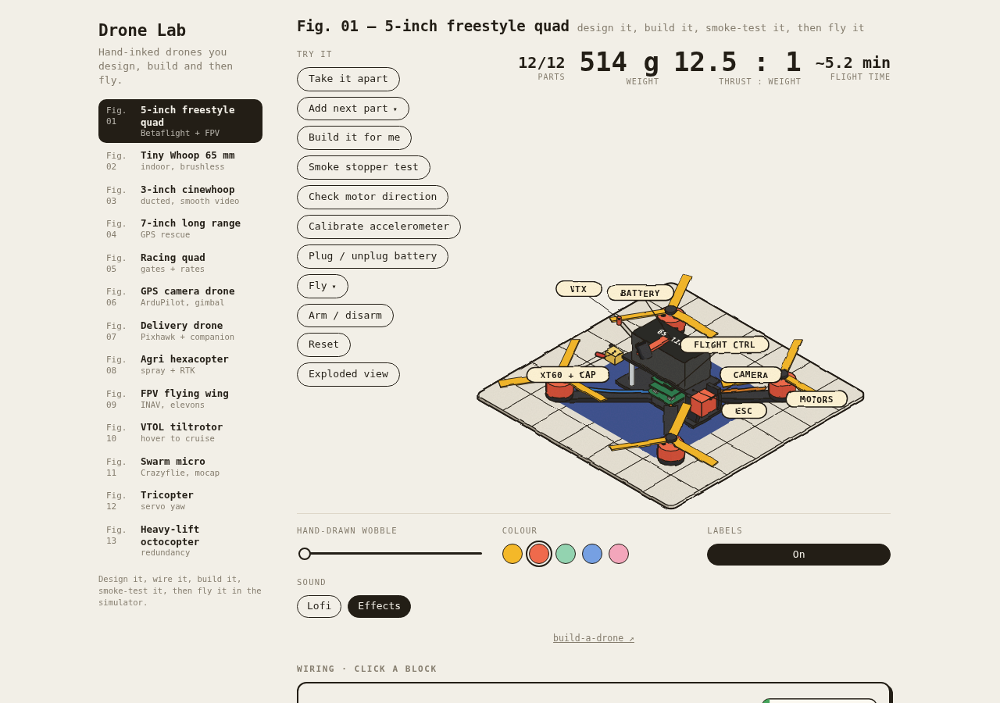

# Drone Lab — build a drone

**Hand-inked drones you design, build, and then fly.** An interactive FPV drone engineering workshop that runs entirely in your browser: pick parts and watch the thrust-to-weight math update, wire the stack, build it part by part on the bench, smoke-test it, check motor direction, calibrate, plug in — then fly it in a simulator that uses the mass and thrust you designed.

A ground-up, independent re-implementation of the interaction design of [drone-engineer.vercel.app](https://drone-engineer.vercel.app) (Drone Lab). Original code, zero runtime dependencies, installable as a PWA.

https://github.com/kanishka-namdeo/build-a-drone



## What's inside

- **13 hand-inked isometric drone figures** — from a 65 mm Tiny Whoop to a 12S heavy-lift octocopter — each drawn as live SVG with a wobbling "hand-inked" filter, 8-band cel shading (cool shadows, warm sheen), gradient-falloff cast shadows, and clickable part callouts.
- **A real workshop loop**: take it apart → add parts in order (polarised parts can be fitted *backwards* on purpose) → smoke-stopper test → motor direction check (one motor is deliberately wrong) → accelerometer calibration → plug in the battery. Make the classic mistakes and they bite: a reversed capacitor vents on plug-in, a backwards flight-controller arrow flips the quad on take-off.
- **A design bench calculator**: batteries × motors × props → all-up weight, thrust-to-weight, hover throttle, max current, hover and freestyle flight time, cost split. The simulator's physics uses your numbers.
- **Wiring diagrams** with clickable, colour-coded blocks (power / data / video / motor phases) for every craft.
- **A flight simulator**: altitude-hold, angle, acro, gate racing, and per-craft autopilots and ranges — GPS Rescue, waypoint missions, a 10-phase delivery run with a winch, a lawn-mower spray mission, VTOL hover↔cruise transitions, a four-drone swarm formation, tail-servo tricopter yaw, and a motor-out octocopter that flies home on seven. The world has weather in it: drifting clouds with moving shadows, a sun, atmospheric haze, mown grass with tufts, lumpy trees, fluttering pylon pennants — and an indoor living room with walls, not a sky. The craft casts an altitude-softened shadow and stirs downwash rings when it hugs the grass.
- **Third-person isometric and FPV goggles views** — the FPV renderer has a full OSD: voltage, current, timer, altitude, speed, artificial horizon, navigation arrow — plus lens vignette, scanlines, and prop arcs in the corners.
- **Firmware-flavoured consoles**: Betaflight / ArduPilot / INAV / cflib / MAVSDK snippets and a serial log that narrates everything you do.
- **Check-yourself quizzes** with persisted answers, and a practice task per craft.
- **PWA**: installable, works offline (service worker with cache-first assets, network-first documents).

## The roster

| Fig | Craft | The lesson |
| --- | --- | --- |
| [01](https://github.com/kanishka-namdeo/build-a-drone/blob/main/assets/media/craft-quad5.png) | 5-inch freestyle quad | the default first FPV build |
| [02](https://github.com/kanishka-namdeo/build-a-drone/blob/main/assets/media/craft-whoop65.png) | Tiny Whoop 65 mm | ducted indoor micro, 1S sag |
| [03](https://github.com/kanishka-namdeo/build-a-drone/blob/main/assets/media/craft-cine35.png) | 3-inch cinewhoop | ducts + a naked action cam |
| [04](https://github.com/kanishka-namdeo/build-a-drone/blob/main/assets/media/craft-lr7.png) | 7-inch long range | Li-ion + GPS Rescue failsafe |
| [05](https://github.com/kanishka-namdeo/build-a-drone/blob/main/assets/media/craft-race5.png) | 5-inch racing quad | rates, gates, dive towers |
| [06](https://github.com/kanishka-namdeo/build-a-drone/blob/main/assets/media/craft-gpscam.png) | GPS camera drone | ArduPilot, waypoints, gimbal |
| [07](https://github.com/kanishka-namdeo/build-a-drone/blob/main/assets/media/craft-delivery.png) | Delivery drone | companion computer + winch |
| [08](https://github.com/kanishka-namdeo/build-a-drone/blob/main/assets/media/craft-agrihexa.png) | Agri hexacopter | spray missions + RTK |
| [09](https://github.com/kanishka-namdeo/build-a-drone/blob/main/assets/media/craft-wing9.png) | FPV flying wing | elevons, stalls, hand launch |
| [10](https://github.com/kanishka-namdeo/build-a-drone/blob/main/assets/media/craft-vtol.png) | VTOL tiltrotor | hover ↔ cruise transitions |
| [11](https://github.com/kanishka-namdeo/build-a-drone/blob/main/assets/media/craft-swarm.png) | Swarm micro | Crazyflie decks + formations |
| [12](https://github.com/kanishka-namdeo/build-a-drone/blob/main/assets/media/craft-tricopter.png) | Tricopter | tail-servo yaw |
| [13](https://github.com/kanishka-namdeo/build-a-drone/blob/main/assets/media/craft-octo.png) | Heavy-lift octocopter | redundancy, motor-out |

A flight from the simulator (third-person → FPV → reset):

https://github.com/kanishka-namdeo/build-a-drone/blob/main/assets/media/flight-demo.webm

## Run it

```bash
npm install
npm run dev        # http://localhost:5173
```

Production build + preview:

```bash
npm run build      # typecheck + bundle into dist/
npm run preview    # http://localhost:4173
```

Tests:

```bash
npm test           # unit: calculator numbers, physics constants, storage, audio
npm run test:e2e   # Playwright: boot, build flow, flight, FPV, all 13 crafts, mobile
```

## Controls

| Key | Action |
| --- | --- |
| `W` / `S` | throttle (climb / descend in altitude-hold) |
| `A` / `D` | yaw |
| arrows | pitch + roll |
| `Space` | arm / disarm |
| `R` | reset to the pad |
| `V` | FPV view on / off |
| `T` | transition / back (VTOL only) |

On touch devices, drag the two on-screen sticks.

## Architecture

Four layers, no framework — vanilla TypeScript + DOM + SVG + WebAudio:

```
src/engine    isometric drawing engine + page shell + audio + storage
src/workshop  bench state machine, calculator, wiring, lesson panels
src/flight    physics, world/collision, third-person + FPV renderers
src/crafts    13 data-driven drone definitions (CraftRecord)
```

Every drone is a data record: catalogue tables, build steps with polarity mistakes, drawing code, wiring map, quiz, and its flying range — plus hooks for the unique mechanics (`calc`, `physics`, `modes`, `extraButtons`...). The engine never special-cases a craft. See [docs/architecture.md](docs/architecture.md) and the [craft authoring guide](docs/guides/adding-a-craft.md).

Verified: 38 unit tests lock the calculator's reference numbers (514 g, 12.5:1, $346 defaults) and the physics constants (12 m geofence, 3.5/3.2 V battery, flip faults, gate/goal logic); 10 Playwright flows cover boot, the manual pedagogy path, flight, FPV, all 13 crafts, quiz persistence, the live calculator, and the mobile layout.

## Credits

- Interaction design inspiration: [Drone Lab](https://drone-engineer.vercel.app) (built with the Colorfigures skill).
- Drone facts are common FPV community knowledge (Betaflight/ArduPilot/INAV docs, vendor spec sheets).

## License

MIT — see [LICENSE](LICENSE).
